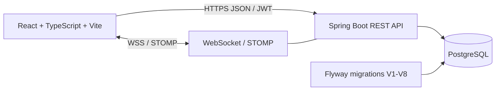

# SYNCORA

**A real-time collaboration platform for teams to coordinate work, communicate, and track projects.**

[](https://syncora-frontend.vercel.app/)
[](https://openjdk.org/projects/jdk/21/)
[](https://spring.io/projects/spring-boot)
[](https://react.dev/)
[](https://www.typescriptlang.org/)
[](https://www.postgresql.org/)

SYNCORA brings workspace collaboration, project and task management, messaging, and activity into one application. It is built with a React and TypeScript frontend and a Java Spring Boot API backed by PostgreSQL.

> **Live deployment note:** The frontend is hosted at [syncora-frontend.vercel.app](https://syncora-frontend.vercel.app/). The configured API is [syncora-backend-gub9.onrender.com](https://syncora-backend-gub9.onrender.com). Hosted service and database availability depend on their providers; see [Deployment](#deployment) for required configuration and [Known limitations](#known-limitations) for storage and real-time constraints.

## Table of contents

- [Features](#features)
- [Screenshots](#screenshots)
- [Architecture](#architecture)
- [Technology stack](#technology-stack)
- [Repository structure](#repository-structure)
- [Prerequisites](#prerequisites)
- [Local development](#local-development)
- [Configuration](#configuration)
- [Database and migrations](#database-and-migrations)
- [API overview](#api-overview)
- [Authentication and security](#authentication-and-security)
- [Testing](#testing)
- [Deployment](#deployment)
- [Known limitations](#known-limitations)
- [Future improvements](#future-improvements)
- [Contributing](#contributing)
- [License](#license)

## Features

- **Authentication and profiles:** Account registration, login, JWT access tokens, and profile management.
- **Workspaces:** Create and manage workspaces and members with role-based access.
- **Workspace setup:** On the Workspaces page, optionally create the requested ten standard team spaces. The action uses the signed-in user's workspace API, skips existing names, and can be safely retried after partial completion.
- **Projects:** Organize workspace projects, manage project members, and archive or restore projects.
- **Tasks:** Assign work, set status, priority, and due dates, and collaborate through comments.
- **Project chat and direct messages:** Persisted conversations with WebSocket/STOMP updates.
- **Notifications and activity:** Review workspace and project events and notifications.
- **File attachments:** Upload, download, and manage files subject to application limits and access checks.
- **Dashboard and calendar:** View workspace and task summaries and browse task due dates.
- **Responsive navigation:** Dashboard, workspace, project, task, messaging, activity, notification, file, and profile pages.

## Screenshots

### Dashboard


The dashboard image is a screenshot of the application with account identifiers and task details redacted. More screenshots can be added under `docs/screenshots/` after capturing them from the real application without personal or confidential data.

## Architecture



The backend is organized around controllers, services, repositories, entities, request/response DTOs, security, and configuration. The frontend separates routes and pages, reusable components, API services, authentication state, types, and utilities.

## Technology stack

| Area | Technologies |
|---|---|
| Backend | Java 21, Spring Boot 4.1.2, Spring Security |
| Data | PostgreSQL 16, Spring Data JPA, Hibernate, Flyway |
| Authentication | JWT, BCrypt |
| Real time | WebSocket, STOMP, Spring simple message broker |
| Frontend | React 19, TypeScript, Vite, React Router |
| Testing | JUnit, Spring integration tests, Vitest, Testing Library |
| Build and local services | Gradle, npm, Docker Compose |
| Hosting | Render (backend), Neon (PostgreSQL), Vercel (frontend) |

## Repository structure

```text
Syncora/
├── backend/
│   ├── src/main/java/com/example/demo/
│   │   ├── config/ controller/ dto/ entity/ enums/
│   │   ├── exception/ repository/ security/ service/
│   └── src/main/resources/db/migration/  # Flyway V1-V8
├── frontend/
│   ├── src/
│   │   ├── api/ auth/ components/ pages/ services/
│   │   ├── test/ types/ utils/
│   └── vercel.json                       # SPA route fallback
├── docs/screenshots/
├── docker-compose.yml
└── README.md
```

## Prerequisites

- Java 21
- Node.js 22.12 or later and npm
- Docker with Docker Compose
- Git

## Local development

### 1. Clone the repository

```powershell
git clone https://github.com/truptiumesh/Syncora.git
Set-Location Syncora
```

### 2. Start PostgreSQL

From the repository root:

```powershell
Copy-Item .env.example .env
# Edit .env and replace both example values with the same local-only password.
docker compose up -d postgres
docker compose ps
```

The local database listens on `localhost:5433`. The root `.env` file is ignored by Git; use a local-only password and never reuse it in production.

### 3. Start the backend

In a PowerShell terminal:

```powershell
Set-Location backend

$localSettings = Get-Content ..\.env | ConvertFrom-StringData
$env:SPRING_DATASOURCE_PASSWORD = $localSettings.SPRING_DATASOURCE_PASSWORD
$rng = [System.Security.Cryptography.RandomNumberGenerator]::Create()
$bytes = New-Object byte[] 32
$rng.GetBytes($bytes)
$rng.Dispose()
$env:JWT_SECRET = [Convert]::ToBase64String($bytes)

.\gradlew.bat --no-daemon bootRun
```

The API starts on port `8080`. Flyway applies pending migrations and Hibernate validates the resulting schema. Do not use the development password or generated local JWT key for a hosted deployment.

### 4. Start the frontend

In a second terminal:

```powershell
Set-Location frontend
npm ci
npm run dev
```

Vite runs at [http://localhost:5173](http://localhost:5173/). Local development uses `http://localhost:8080` as the API default. If the backend is elsewhere, configure `VITE_API_BASE_URL` before starting Vite.

## Configuration

Environment variables are supplied to the backend process or frontend build. Do not commit populated `.env` files, passwords, database URLs with credentials, or JWT secrets.

### Backend

| Variable | Purpose | Local default / example |
|---|---|---|
| `SPRING_DATASOURCE_URL` | PostgreSQL JDBC URL | `jdbc:postgresql://localhost:5433/syncora_db` |
| `SPRING_DATASOURCE_USERNAME` | Database user | `syncora_user` |
| `SPRING_DATASOURCE_PASSWORD` | Database password | Set it in the ignored root `.env` file for local development |
| `JWT_SECRET` | Base64-encoded HMAC signing key (at least 256 bits) | Generate a distinct random value for each environment |
| `CORS_ALLOWED_ORIGINS` | Comma-separated browser origin allowlist | `http://localhost:5173,http://127.0.0.1:5173,https://syncora-frontend.vercel.app` |
| `CORS_ALLOWED_ORIGIN` | Legacy single-origin CORS override | Prefer `CORS_ALLOWED_ORIGINS` |
| `SYNCORA_MAX_FILE_SIZE` | Maximum uploaded file size | `10MB` |
| `SYNCORA_MAX_REQUEST_SIZE` | Maximum multipart request size | `11MB` |
| `SYNCORA_FILE_STORAGE_DIR` | Local attachment storage directory | `./var/syncora/uploads` |
| `PORT` | HTTP port provided by the host | `8080` |

For production, set `CORS_ALLOWED_ORIGINS` to the exact deployed frontend origin. The local and published Vercel origins are included in the application fallback; an explicitly configured environment value takes precedence.

### Frontend

| Variable | Purpose | Production value |
|---|---|---|
| `VITE_API_BASE_URL` | API origin baked into the Vite build | `https://syncora-backend-gub9.onrender.com` |

An example is in [`frontend/.env.production.example`](frontend/.env.production.example). Vite environment variables are public build-time configuration; never put secrets in `VITE_*` variables.

## Database and migrations

PostgreSQL is the application database. Flyway manages schema migrations **V1–V8**. Hibernate is configured with `ddl-auto=validate`; it does not create or update the schema. Back up important data before applying future migrations.

For Neon, configure the backend datasource URL, username, and password in the hosting provider's secret environment settings. Use the provider's SSL-enabled JDBC connection settings. Do not import local database backups into the hosted database as part of routine deployment.

## API overview

Routes use the `/api/v1` prefix.

| Area | Routes |
|---|---|
| Authentication | `/auth/register`, `/auth/login` |
| Current user/profile | `/users/me` |
| Workspaces and membership | `/workspaces`, `/workspaces/{workspaceId}/members` |
| Projects | `/workspaces/{workspaceId}/projects`, `/projects/{projectId}` |
| Tasks and comments | `/projects/{projectId}/tasks`, `/tasks/{taskId}` |
| Project chat | `/projects/{projectId}/messages`, `/messages/{messageId}` |
| Direct messaging | `/workspaces/{workspaceId}/direct-conversations`, `/direct-conversations/{conversationId}/messages` |
| Notifications and activity | `/notifications`, `/activity` |
| Attachments | `/workspaces/{workspaceId}/files`, `/projects/{projectId}/files`, `/files/{fileId}/download` |
| Health | `/actuator/health` |

Authenticated REST requests use a bearer token in the `Authorization` header. WebSocket connections use the STOMP endpoint `/ws`. There is no generated OpenAPI specification currently included in the repository.

## Authentication and security

- Passwords are BCrypt-hashed by the backend.
- JWTs expire after 15 minutes; the frontend keeps the access token in memory rather than `localStorage`.
- If a protected API request returns `401`, the frontend clears the in-memory session and returns to sign-in with an expiration message. Sign in again to continue.
- Backend authorization checks workspace membership and project/resource permissions.
- Upload limits and supported file types are enforced server-side.
- CORS is restricted to configured origins; do not use a wildcard for hosted deployments.
- Secrets belong in local environment variables or the hosting provider's protected environment settings, never source control.

## Testing

Frontend:

```powershell
Set-Location frontend
npm test
npm run build
```

Backend:

```powershell
Set-Location backend
.\gradlew.bat --no-daemon clean test
.\gradlew.bat --no-daemon build
```

Backend integration tests use PostgreSQL and the configured local database. Review test configuration before running tests against any database containing data you need to preserve.

## Deployment

Deployment configuration depends on the selected provider dashboard. No provider credentials or private deployment logs are stored in this repository.

### Render backend

1. In Render, open the backend Web Service (or create one from this repository).
2. Set **Root Directory** to `backend` and choose the Docker runtime using `backend/Dockerfile`.
3. Configure the environment variables from the [backend table](#backend), especially `SPRING_DATASOURCE_URL`, `SPRING_DATASOURCE_USERNAME`, `SPRING_DATASOURCE_PASSWORD`, `JWT_SECRET`, and `CORS_ALLOWED_ORIGINS`.
4. Keep `JWT_SECRET` set to the same stable, randomly generated secret across service restarts and all backend instances. Rotating it invalidates every token issued with the previous key; after intentional rotation, users must sign in again.
5. For Neon, use the SSL-enabled connection values from the Neon project dashboard.
6. Set the health check path to `/actuator/health`.
7. Deploy and wait for the service to report healthy before testing authentication or data operations.

Generate a signing secret locally instead of reusing a checked-in value:

```powershell
$rng = [System.Security.Cryptography.RandomNumberGenerator]::Create()
$bytes = New-Object byte[] 32
$rng.GetBytes($bytes)
$rng.Dispose()
[Convert]::ToBase64String($bytes)
```

Copy the result directly into Render's protected `JWT_SECRET` setting. Do not paste it into chat or source files.

### Vercel frontend

1. Open the Vercel project settings and confirm **Root Directory** is `frontend`.
2. Use the Vite build command `npm run build` and output directory `dist`.
3. Add `VITE_API_BASE_URL=https://syncora-backend-gub9.onrender.com` to the Production environment.
4. Redeploy after changing build-time variables.
5. The [`frontend/vercel.json`](frontend/vercel.json) rewrite sends client-side routes such as `/login` and `/dashboard` to the Vite app, so refreshing a route does not return a hosting-provider 404.

The browser should make API calls to the Render origin, not to `localhost` or the Vercel origin. Test login from the deployed site only after Render health and CORS preflight respond successfully.

### Neon database

1. Open the Neon project and select the intended production database and role.
2. Copy the SSL-enabled connection details into Render's protected datasource environment settings.
3. Do not reset the database or import local data. Flyway should validate/apply pending migrations at application startup.
4. Verify Render startup logs and `/actuator/health`; no Neon dashboard access or production migration result is asserted by this repository documentation.

### Uploaded files and real-time operation

The application currently stores attachments in the local filesystem. The Render configuration in this repository does **not** configure persistent storage or object storage; files may not survive instance replacement/redeploy. Do not rely on production uploads until persistent disk or object storage is configured and verified.

The Spring simple message broker is in-memory and suited to a single backend instance. Multi-instance message delivery requires a shared broker or equivalent fanout.

## Known limitations

- No refresh-token or server-side JWT revocation flow; browser refresh clears the in-memory session.
- Account recovery and email verification are not implemented.
- Profile images are URL-based.
- Local filesystem file storage is not configured for production persistence.
- The in-memory STOMP broker does not provide multi-instance fanout.
- The project does not include automated browser end-to-end tests or an API OpenAPI specification.

## Future improvements

- Persistent cloud file storage.
- Refresh-token rotation and token revocation.
- Email verification and account recovery.
- Shared message broker for horizontally scaled WebSocket delivery.
- Browser end-to-end and deployment smoke tests.
- OpenAPI documentation.

## Contributing

Issues and pull requests are welcome. Before proposing a change, check existing project patterns, add or update targeted tests, and document any configuration changes. Never include credentials, user data, database backups, or screenshots containing private information.

## License

No license file is currently present. Unless a license is added, no open-source reuse license is explicitly granted.

---

**Repository:** [github.com/truptiumesh/Syncora](https://github.com/truptiumesh/Syncora)

**Live frontend:** [syncora-frontend.vercel.app](https://syncora-frontend.vercel.app/)
