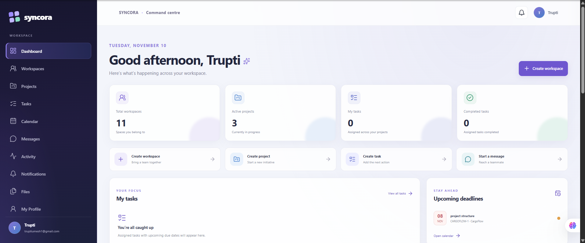

# SYNCORA – Real-Time Collaboration Platform

SYNCORA is a full-stack, real-time collaboration platform designed to bring team communication, project coordination, task management, and workspace collaboration into one unified experience.

Built with **Java, Spring Boot, React, TypeScript, and PostgreSQL**, SYNCORA provides workspace-based team management, project tracking, real-time messaging, notifications, activity feeds, and file sharing.

## Features

- **Authentication and user profiles** – Account registration, login, JWT authentication, and profile management.
- **Workspace and team management** – Create workspaces, manage members, and enforce role-based permissions.
- **Project management** – Create, update, archive, restore, and organize workspace projects.
- **Task management** – Create and assign tasks, track status and priority, set due dates, and collaborate through comments.
- **Real-time project chat** – Persistent project conversations with message editing and deletion.
- **Notifications and activity feed** – Track important workspace and project events.
- **File management** – Upload, download, and manage workspace and project attachments.
- **Direct messaging** – One-to-one conversations between workspace members.
- **Personalized dashboard** – View workspace summaries, projects, assigned tasks, and recent activity.
- **Calendar** – View task due dates through calendar views.

## Technology Stack

| Layer | Technologies |
|---|---|
| Backend | Java 21, Spring Boot, Spring Security |
| Frontend | React, TypeScript, Vite |
| Database | PostgreSQL 16 |
| ORM and migrations | Spring Data JPA, Hibernate, Flyway |
| Authentication | JWT, BCrypt |
| Real-time communication | WebSocket, STOMP |
| Build tools | Gradle, npm |
| Infrastructure | Docker Compose |

## Architecture

SYNCORA uses a frontend/backend architecture:

```text
                 SYNCORA
                    |
          +---------+---------+
          |                   |
      Frontend             Backend
   React + TypeScript    Spring Boot
          |                   |
          | REST API          |
          | WebSocket         |
          +---------+---------+
                    |
                PostgreSQL
                    |
              Flyway Migrations
```

The backend separates controllers, services, repositories, entities, DTOs, security, and configuration. The frontend separates pages, reusable components, API services, types, and authentication state.

## Screenshots

### Dashboard



## Requirements

- Java 21
- Node.js 22 or later
- npm
- Docker with the Docker Compose plugin

## Run Locally

### 1. Clone the repository

```powershell
git clone https://github.com/truptiumesh/Syncora.git
cd Syncora
```

### 2. Start PostgreSQL

From the project root:

```powershell
docker compose up -d postgres
docker compose ps
```

PostgreSQL runs on `localhost:5433`.

The development database is `syncora_db`. The development credentials are configured in `docker-compose.yml`; do not reuse them in production.

### 3. Start the backend

Open a PowerShell terminal:

```powershell
cd backend

$env:SPRING_DATASOURCE_PASSWORD = "syncora_dev_password"

$rng = [System.Security.Cryptography.RandomNumberGenerator]::Create()
$bytes = New-Object byte[] 32
$rng.GetBytes($bytes)
$rng.Dispose()
$env:JWT_SECRET = [Convert]::ToBase64String($bytes)

.\gradlew.bat bootRun
```

The backend runs on port `8080`.

Set the environment variables again in any new terminal before starting the backend.

Flyway automatically applies pending database migrations. Hibernate uses `ddl-auto=validate` to validate the migrated schema.

### 4. Start the frontend

Open a second PowerShell terminal:

```powershell
cd frontend
npm ci
npm run dev
```

The frontend runs at:

http://localhost:5173

### 5. Run tests and build

Backend:

```powershell
cd backend
.\gradlew.bat test
.\gradlew.bat build
```

Frontend:

```powershell
cd frontend
npm test
npm run build
```

## Project Structure

```text
Syncora/
├── backend/
│   ├── src/main/java/com/example/demo/
│   │   ├── config/
│   │   ├── controller/
│   │   ├── dto/
│   │   ├── entity/
│   │   ├── enums/
│   │   ├── exception/
│   │   ├── repository/
│   │   ├── security/
│   │   └── service/
│   └── src/main/resources/
│       └── db/migration/
│
├── frontend/
│   └── src/
│       ├── api/
│       ├── auth/
│       ├── components/
│       ├── pages/
│       ├── services/
│       ├── test/
│       ├── types/
│       └── utils/
│
├── docker-compose.yml
├── .gitignore
└── README.md
```

## API Overview

Backend API routes use the `/api/v1` prefix.

| Module | Main API routes |
|---|---|
| Authentication | `/auth/register`, `/auth/login` |
| User profiles | `/users/me` |
| Workspaces | `/workspaces` |
| Projects | `/workspaces/{workspaceId}/projects`, `/projects/{projectId}` |
| Tasks | `/projects/{projectId}/tasks`, `/tasks/{taskId}` |
| Project chat | `/projects/{projectId}/messages`, `/messages/{messageId}` |
| Notifications | `/notifications` |
| Activity | `/activity`, `/workspaces/{workspaceId}/activity` |
| Files | `/workspaces/{workspaceId}/files`, `/projects/{projectId}/files`, `/files/{fileId}/download` |
| Direct messaging | `/workspaces/{workspaceId}/direct-conversations`, `/direct-conversations/{conversationId}/messages` |

Protected endpoints require a bearer JWT:

```http
Authorization: Bearer <token>
```

The API enforces workspace membership, project permissions, and resource-level authorization on the backend.

## Database and Migrations

Flyway manages database schema changes through migrations V1–V8.

The migrations cover:

- Users and authentication
- Workspaces and workspace memberships
- Projects and project memberships
- Tasks and task comments
- Project chat messages
- Notifications and activity records
- File attachment metadata
- Direct conversations and messages

Hibernate validates the database schema instead of automatically creating or updating tables.

## Security

- Passwords are hashed using BCrypt.
- JWT signing keys are provided through environment variables.
- Access tokens expire after 15 minutes.
- The frontend keeps access tokens in JavaScript memory rather than browser storage.
- Workspace and project access is enforced by backend authorization rules.
- File uploads use generated storage identifiers and server-side file-type validation.
- Sensitive configuration should be supplied through environment variables, not committed to Git.

## Current Limitations

- Access tokens are not persisted across browser refreshes.
- Logout clears the client-side token but does not revoke an already-issued JWT.
- Account recovery and email verification are not implemented.
- Profile images are provided through URLs.
- Real-time messaging uses Spring's in-memory simple broker and is intended for a single backend instance.
- Uploaded files use local filesystem storage; cloud storage and multi-server file sharing are not implemented.
- Direct messages and project chat do not have multi-instance message fanout.

## Future Improvements

- Production deployment and hosted database infrastructure
- Cloud-based file storage
- Refresh-token and token-revocation support
- Email verification and password recovery
- Scalable real-time messaging infrastructure
- Automated CI/CD pipelines
- Expanded integration and end-to-end testing

## Repository

**GitHub:** https://github.com/truptiumesh/Syncora

---

*SYNCORA – Bringing teams, projects, and conversations together.*